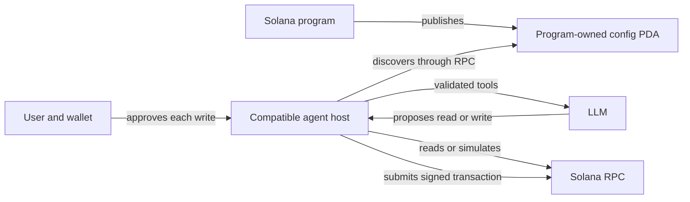

# Web3MCP

Web3MCP is a candidate Solana protocol for publishing agent-facing tools in a **program-owned config PDA**. A compatible host discovers those tools through Solana RPC, reads accounts, and prepares program instructions for a user to approve with a wallet. The target program needs no website, custom API, or MCP server.

Explore the [website and documentation](https://www.web3mcp.org).

## How it works

1. A Solana program publishes a versioned config and embedded Anchor IDL in its canonical PDA, derived from `["web3mcp", "config"]` and the program ID.
2. A host starts with that program ID, verifies the executable program and PDA ownership, then validates the config and tool bindings.
3. The host gives validated tools to its model. Read tools fetch accounts through RPC. Write tools build and simulate an instruction and wait for the user's wallet approval.



The PDA stores **tool declarations, not executable tools**. Solana program instructions perform writes. Web3MCP uses no MCP server, MCP client, or transport adapter; the example host connects to its model separately.

## What is in this repository

| Component | Purpose |
| --- | --- |
| [Protocol](protocol/README.md) | Candidate v0.1 specification, v0.2 account-read PDA extension, JSON Schema, validator, fixtures, and conformance tests. |
| [Node.js SDK](packages/sdk/README.md) | `@web3mcp/sdk`: generic discovery, account reads, instruction preparation, simulation, and signed submission. |
| [Web3MCP Compatible Host CLI](apps/host/README.md) | Terminal chat with model tools, on-demand discovery, RPC settings, wallet selection, and explicit signing approval. |
| [Reference vault](reference-programs/reference-vault/README.md) | Anchor SOL vault and authorized publisher for its program-owned config PDA. |
| [Website](apps/website/README.md) | Landing page, quickstart, protocol documentation, and pitch materials at [web3mcp.org](https://www.web3mcp.org); independent of tool execution. |

Only `@web3mcp/sdk` is published to npm. The protocol source remains here as the specification and conformance reference; the Host CLI is an example application. The SDK and host do not import the reference vault's source or generated IDL.

## Try the example host

Use Node.js **22 or later** and a terminal. From the repository root:

```bash
npm ci
npm run test:host
npm run host
```

Chat opens by default. Type `/model` to choose a provider, enter its API key, and select a model; `/rpc` selects the Solana endpoint. The default RPC is Devnet. The host saves API keys in the operating system credential store when available and keeps non-secret settings separately. Reads work without a wallet. For writes, use `/wallet` to select a detected keypair or enter a path. Keep keypair files and API keys outside this repository.

Try: **“Read my vault using program ID `9zJzM4rHDPR4pd3vXHQjQ7whTVmx4zxB3ZH4Gb9iXRwD`.”** The model can discover the program's published tools and read a vault by its owner's wallet address. For a write, the host shows the simulated transaction and signs with the selected keypair only after you press **Sign**. Type `/` for the full command menu.

The protocol starts from a program ID. The example host can also resolve a current `.sns` name to a program ID before discovery; `.sol` resolution is not supported.

## Use the SDK in another Node.js host

```bash
npm install @web3mcp/sdk @solana/web3.js
```

```js
import { Connection } from '@solana/web3.js';
import { Web3McpSdk } from '@web3mcp/sdk';

const programId = '9zJzM4rHDPR4pd3vXHQjQ7whTVmx4zxB3ZH4Gb9iXRwD';
const sdk = new Web3McpSdk({
  connection: new Connection('https://api.devnet.solana.com'),
});

await sdk.discover(programId);
console.log(sdk.getTools(programId).map(({ name }) => name));

const vault = await sdk.executeRead(
  'get_vault_by_owner',
  { ownerAddress: '<wallet-public-key>' },
  { programId },
);
console.log(vault);
```

For writes, the SDK exposes `prepareInstruction()` and `submitSignedTransaction()`. The host must show the preparation and simulation to the user, obtain a wallet signature, and submit the signed transaction. See the [SDK guide](packages/sdk/README.md) for the exact flow and failure handling. The SDK contains no model, terminal UI, or wallet file reader.

## Reference vault on Devnet

The current reference program is `9zJzM4rHDPR4pd3vXHQjQ7whTVmx4zxB3ZH4Gb9iXRwD`. Its config PDA is `J8Ph37LoQsv4yED6USdupCooCZzsVMqJkgBTm9uSkvCw`. It publishes five tools:

| Tool | Purpose |
| --- | --- |
| `get_vault_by_owner` | Derive and read a vault from its owner's wallet address. |
| `get_vault` | Read a vault by its exact PDA address. |
| `initialize` | Create a vault for the signing owner. |
| `deposit` | Deposit SOL into the owner's vault. |
| `withdraw` | Withdraw SOL from the owner's vault. |

Program authors can use the [reference implementation](reference-programs/reference-vault/README.md) to see config publication and the [protocol specification](protocol/SPEC.md) for the account layout and validation rules. An existing program needs to implement and publish a compatible config; Web3MCP does not make unrelated programs discoverable automatically.

## Trust and approval

- On discovery, the SDK verifies the executable program, config PDA address and owner, publication status, payload digest, version, IDL, tool bindings, and arguments. Unsupported or ambiguous declarations fail closed. For writes, it checks that the config and program deployment still match discovery before preparation and submission.
- Published descriptions and claimed effects are untrusted input. On-chain ownership identifies the publisher; it does not prove that a tool is safe.
- Read tools need no signature. For writes, the model proposes an action, the SDK prepares and simulates it, and the user approves the exact transaction. The model never receives signing authority.

## Develop and verify

```bash
npm ci                              # Root dependencies
npm test                            # Protocol, SDK, host, and repository checks
npm ci --prefix apps/website        # Website dependencies
npm run dev                         # Website at http://localhost:3000
npm run build                       # Production website build
```

The protocol validator can check a JSON fixture or serialized config account offline:

```bash
node protocol/bin/validate.js protocol/fixtures/valid/reference-instruction.json
```

For the reference program's local-validator integration suite, install Rust, Solana, and Anchor, use a disposable wallet outside the repository, and follow the [vault setup](reference-programs/reference-vault/README.md). The suite contains 38 tests, including an SDK-backed signed write.

## Status and documentation

[@web3mcp/sdk](https://www.npmjs.com/package/@web3mcp/sdk) is public, and the [website](https://www.web3mcp.org) is live. The reference vault and v0.2 config are deployed on Devnet; SDK discovery found all five tools, and a fresh public SDK install repeated that discovery. The local-validator integration suite passed, and a basic provider-backed OpenAI chat worked. The protocol remains a candidate while adversarial conformance coverage is reviewed.

Pending: a full provider-backed Devnet CLI read/write rehearsal and a second compatible-program demo. See the [roadmap](docs/roadmap.md) for acceptance criteria.

- [Whitepaper](docs/whitepaper.md)
- [Protocol specification](protocol/SPEC.md) and [conformance guide](protocol/README.md)
- [Project design](docs/superpowers/specs/2026-10-13-web3mcp-project-design.md)
- [SDK guide](packages/sdk/README.md), [Host CLI guide](apps/host/README.md), and [npm release guide](docs/npm-release.md)
- [Contributing](CONTRIBUTING.md), [security policy](SECURITY.md), [protocol change process](docs/protocol-changes.md), and [dependency status](docs/dependency-security.md)

Licensed under [Apache 2.0](LICENSE).
