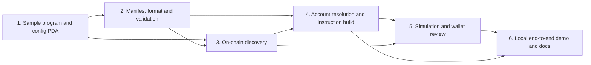

# Web3MCP Implementation Plan

**Status:** Superseded technical draft. Use the [current project design](../specs/2026-10-13-web3mcp-project-design.md) and [demo roadmap](../../roadmap.md). This plan predates the generic LLM host and documentation site and prioritizes SNS, which is now deferred.

> **For agentic workers:** REQUIRED SUB-SKILL: Use superpowers:subagent-driven-development (recommended) or superpowers:executing-plans to implement this plan task-by-task. Steps use checkbox (`- [ ]`) syntax for tracking.

**Goal:** Prove that a program author can publish a self-contained Web3MCP config in its own PDA and that an independent Web3MCP-capable agent can discover the program by SNS name or program ID, read state, and prepare, simulate, and request wallet approval for transactions.

**Architecture:** Store a v0.1 JSON config containing the supported Anchor IDL, WebMCP-shaped tool declarations, and Solana bindings in an `agent-cap` PDA owned by the sample program. A minimal reference agent uses generic SNS resolution, Solana RPC, and its existing wallet interface to read that config, perform account reads, build one Anchor instruction, simulate it, and request approval before submission. There is no MCP server/client or separate Web3MCP SDK deliverable. An Anchor SOL vault supplies `get_vault`, `initialize`, `deposit`, and `withdraw` on a local validator.

**Tech Stack:** Rust 1.91.1, Anchor 0.32.1, Node 24.x, TypeScript, pnpm, Solana local validator, SNS resolver SDK, `@coral-xyz/anchor`, and standard Solana RPC. Use the parent Fall School Nix environment and verify actual installed versions before choosing package pins.

**Spec:** [2026-10-09-web3mcp-design.md](../specs/2026-10-09-web3mcp-design.md)

## Global Constraints

- Protocol `standard`: `web3mcp`; `version`: `0.1.0`; target program PDA seed: `agent-cap`; top-level tool list: `tools`.
- The program-owned `agent-cap` account contains the complete v0.1 config: standard `web3mcp`, version `0.1.0`, `programId`, complete supported Anchor `idl`, and `tools`; application-level maximum config size 64 KiB.
- Publish and update configs through begin, ordered chunk writes, and finalize. Agents ignore configs unless finalized; interrupted updates make the config unavailable until publication completes.
- Tool kinds: account reads and one Anchor instruction per transaction tool. Inputs: `u64` (decimal string), `bool`, `publicKey`; no floats, remaining accounts, address lookup tables, dynamic lookups, or executable resolver code.
- State-changing transaction always needs fresh explicit approval of the exact message by a wallet through the agent wallet. No private key or secret is stored in the config; the existing wallet owns signing and submission.
- WebMCP-shaped tool descriptor fields are `name`, optional `title`, `description`, `inputSchema`, and optional `annotations`; Solana's execution binding is `solana.kind` plus account/instruction fields.
- Default on-chain tool set for a stateful user-facing program: `accountRead` tools for important user-readable state plus `instruction` tools for supported user actions. Sample: `get_vault`, `initialize`, `deposit`, `withdraw`. SNS resolution, config fetch, decoding, building, simulation, wallet signing, submit, and confirm are agent runtime operations, not config-declared tools.
- `solana.effects` is untrusted publisher metadata. Simulation can fail or go stale; never describe it as a guaranteed effect.
- Sample `agent_vault`: `vault = PDA(["vault", owner public key], program ID)`; owner-only `initialize`, `deposit`, `withdraw`; withdrawal cannot invade rent reserve.
- Local validator and devnet only. Devnet publication is a separate release step; no mainnet target.

## Review Focus

These are the five input/condition classes most likely to break a real user. Each is pinned in a task below.

1. An unresolved SNS name or name resolving to a non-executable address fails before config lookup (Task 3).
2. Embedded IDL disagrees with tool bindings or the config changes between discovery and handoff; validation or handoff stops (Tasks 2 and 5).
3. A requested lamport amount is zero, negative, fractional, malformed, or above `u64::MAX`; validation rejects it before any RPC mutation (Tasks 2 and 4).
4. A read tool points to an account with a wrong owner/discriminator, or a transaction account cannot be resolved; it returns an error or construction fails before simulation (Tasks 4–5).
5. Simulation fails, omits a critical account, or cannot explain a financial debit; wallet handoff is blocked or marked unknown as specified, never silently treated as safe (Task 5).

---

## File map

| Path | Responsibility |
| --- | --- |
| `Anchor.toml`, `Cargo.toml`, `reference-programs/agent_vault/Cargo.toml`, `reference-programs/agent_vault/src/lib.rs` | Small local-validator sample program and program-owned tool-config PDA |
| `package.json`, `pnpm-lock.yaml`, `tsconfig.json` | One TS workspace using the parent environment; no framework or web app |
| `protocol/web3mcp.schema.json`, `protocol/README.md`, `protocol/fixtures/*` | Normative wire shape and interoperability vectors |
| `src/manifest.ts`, `src/discovery.ts`, `src/read.ts`, `src/prepare.ts`, `src/review.ts` | Private reference-agent modules for config parsing, SNS/direct-ID discovery, account reads, instruction construction, simulation, and wallet handoff; no published SDK/API |
| `scripts/build-config.ts`, `scripts/publish-local.ts`, `scripts/demo.ts` | Generate self-contained sample config from compiled IDL, publish it on local validator, run the sample using an existing wallet interface |
| `tests/manifest.test.ts`, `tests/discovery.test.ts`, `tests/read.test.ts`, `tests/prepare.test.ts`, `tests/review.test.ts`, `tests/agent-vault.ts`, `tests/e2e.test.ts` | Unit, adversarial, program, and end-to-end evidence |
| `README.md` | Reproducible setup, runbook, trust boundaries, independent-agent trial |

Generated `target/` output, wallets, RPC logs, and secrets are ignored. No existing file in this empty capstone directory needs modification; the parent repo's `hello_solana` example is a pattern to read, not a dependency to change.

## Task dependencies

Task 1 fixes the config account and embedded IDL shape. Tasks 2 and 3 can proceed independently once Task 1's interface is stable; transaction preparation waits for both validation and discovery.

### Task 1: Verify the substrate and implement the sample vault plus on-chain config account

**Files:** Create `Anchor.toml`, `Cargo.toml`, `reference-programs/agent_vault/Cargo.toml`, `reference-programs/agent_vault/src/lib.rs`, `package.json`, `tsconfig.json`, `.gitignore`, `tests/agent-vault.ts`; generate `pnpm-lock.yaml`.

**Interfaces:** Produces Anchor instructions `initialize()`, `deposit(amountLamports: u64)`, `withdraw(amountLamports: u64)`, `begin_agent_config_upload(totalLength: u32, sha256: [u8; 32])`, `append_agent_config_chunk(offset: u32, bytes: Vec<u8>)`, `finalize_agent_config_upload()`, and `set_agent_config_authority(newAuthority: Pubkey)`. `Vault { owner: Pubkey }` is derived from `[b"vault", owner.as_ref()]`. `AgentConfig { authority: Pubkey, config: Vec<u8>, totalLength: u32, sha256: [u8; 32], published: bool }` is derived from `[b"agent-cap"]` under the program ID. Initialization establishes the config authority using the sample program's documented admin/bootstrap rule. Later tasks consume the account layout, compiled Anchor IDL, and deployed program ID.

- [ ] **Step 1: Verify environment and publication constraints.** Run from the parent repository: `nix develop --command ./scripts/verify-versions.sh`; confirm the parent toolchain. Keep the 64 KiB application cap distinct from Solana's account and transaction limits. Size upload chunks against the fully serialized transaction, not only the instruction data.
- [ ] **Step 2: Write failing program tests.** In `tests/agent-vault.ts`, assert initialize creates the owner PDA; deposit of 1,000,000 lamports increases its available balance; withdraw of 500,000 credits the same owner; a different signer, zero amount, duplicate initialize, wrong vault, and overdraw/rent-reserve cases fail. For the config PDA, assert begin/chunk/finalize with ordered chunks, valid length and digest, rejection of wrong signer, out-of-order or repeated offsets, invalid digest, interrupted upload, update authority rotation, and rejection above 64 KiB. Fee changes must be accounted for when asserting balances.
- [ ] **Step 3: Run the tests and observe failure.** `anchor test --skip-build` should fail because the program/IDL does not exist yet; then build with `anchor build` and run `anchor test` to drive the implementation.
- [ ] **Step 4: Implement the vault and chunked config publication.** Use Anchor account constraints for signer, seeds, owner and mutability; use the System Program for deposits and checked direct lamport changes for owner-only withdrawals while preserving rent. Accept sequential config chunks sized so each complete transaction stays within the serialized transaction limit. Mark the config unpublished at upload start; require exact offsets and expected total length; verify SHA-256 and the 64 KiB cap before marking it published. Only its configured authority may upload or rotate authority. Keep all tests in Step 2 green.
- [ ] **Step 5: Verify deployment and config ownership.** `anchor test` and `cargo test` pass on a local validator. Generate the compiled sample IDL and exact config, measure serialized bytes and required storage deposit, and confirm they fit the v0.1 cap. Derive `agent-cap` from the program ID, fetch it, and assert the account owner is `agent_vault`; publish and update the config with the authorized signer and confirm an interrupted upload is never exposed as usable and a different signer cannot change it. Commit this task as `feat: add sample agent vault and on-chain tool config` when implementation is authorized.

### Task 2: Freeze the Web3MCP config format and vectors

**Files:** Create `protocol/web3mcp.schema.json`, `protocol/README.md`, `protocol/fixtures/valid-config.json`, `protocol/fixtures/invalid-*.json`, `protocol/fixtures/vectors.json`, `src/manifest.ts`, `tests/manifest.test.ts`, `scripts/build-config.ts`.

**Interfaces:** `parseConfig(bytes: Uint8Array, expectedProgramId: string): Web3McpConfig` throws a typed validation error; `validateInputs(tool: AgentTool, values: Record<string, unknown>): Record<string, bigint | boolean | string>`; `build-config` consumes the compiled IDL and produces the sample config with an embedded `idl` object.

- [ ] **Step 1: Write failing tests with exact fixtures.** A valid `standard:"web3mcp"` config with instruction and account-read tools parses; wrong standard/version, unknown fields, duplicate names, malformed tool-kind fields, extra/missing instruction args, wrong `programId`, malformed embedded IDL, and >64 KiB config fail. `validateInputs` validates against `inputSchema`, accepts `"1"` and `"18446744073709551615"` as `u64`; rejects `"0"` for amount-bearing tools, `"-1"`, `"1.5"`, `"01"`, `"18446744073709551616"`, and invalid Base58.
- [ ] **Step 2: Run `pnpm test -- tests/manifest.test.ts`; confirm the named failures.**
- [ ] **Step 3: Implement the schema/parser with the installed validator pattern.** Validate the embedded IDL object against the supported profile and cross-check tool declarations against instruction/account names and argument shapes. Pin an exact config fixture and PDA derivation vector. Keep parser errors stable enough for independent agents to distinguish unsupported version from malformed data. If the installed libraries already validate JSON Schema, reuse them; add no dependency solely for simple checks.
- [ ] **Step 4: Run `pnpm test -- tests/manifest.test.ts` and `pnpm typecheck`; both pass.** Commit as `feat: define Web3MCP config v0.1` when authorized.

### Task 3: Discover program-owned config and embedded IDL

**Files:** Create `src/discovery.ts`, `tests/discovery.test.ts`, `scripts/publish-local.ts`.

**Interfaces:** `discoverConfig(rpc: SolanaRpc, snsOrProgramId: string): Promise<{programId: string; config: Web3McpConfig; fingerprint: string}>`. SNS input resolves to a public key; direct program IDs skip SNS. Verify the address is executable, fetch the program-owned config PDA, and use its embedded IDL. `fingerprint` binds the SNS resolution and config-account data for recheck in Task 5.

- [ ] **Step 1: Write failing discovery tests.** Resolve the registered SNS name to the sample program and separately discover by direct program ID; both return the same tools. Test unresolved name, a name resolving to a non-executable wallet, missing or unpublished config PDA, wrong account owner, bad discriminator, malformed config or embedded IDL, and wrong target program.
- [ ] **Step 2: Run `pnpm test -- tests/discovery.test.ts`; confirm the failures.**
- [ ] **Step 3: Implement SNS and direct-ID discovery.** Set the sample domain's SOL record to the program address. Configure SNS PDA resolution with an allowlist containing the program ID; reject unresolved names and non-executable results. Direct IDs undergo the same executable check. Derive the PDA under the target program ID; verify account owner, Anchor discriminator, `published` status, serialized authority, config size and fingerprint before calling `parseConfig`. Never fetch a separate IDL or use a URL/third-party metadata record as the tool config.
- [ ] **Step 4: Run discovery tests twice against a fresh local validator and `pnpm typecheck`; pass.** Commit as `feat: discover Web3MCP tools by SNS name` when authorized.

### Task 4: Read account tools and prepare instruction tools

**Files:** Create `src/read.ts`, `src/prepare.ts`, `tests/read.test.ts`, `tests/prepare.test.ts`.

**Interfaces:** In the reference agent, `readAccountTool(config: Web3McpConfig, name: string, inputs: Record<string, unknown>): Promise<DecodedAccount>` fetches an embedded-IDL-described account and returns decoded data plus address, owner, and slot. `prepareInstructionTool(config: Web3McpConfig, name: string, inputs: Record<string, unknown>, signer: string): Promise<PreparedInstruction>` returns `programId`, `instruction`, ordered `accountMetas`, canonicalized `inputs`, and config fingerprint. These are reference-agent internals, not a separately published client library; wallet signing remains with the agent's existing wallet interface.

- [ ] **Step 1: Write failing tests.** For `get_vault`, resolve owner input to the expected vault PDA, decode the owner and lamport balance, and assert it makes no wallet call. Reject wrong program owner, wrong discriminator, missing account, and invalid owner input. For `initialize`, `deposit("1000000")`, and `withdraw("500000")`, compare instruction bytes and ordered account metas with an independently generated Anchor client instruction. Reject unknown tool, missing/extra input, unresolved/circular IDL default, injected account, wrong program, and signer/writable privilege mismatch.
- [ ] **Step 2: Run `pnpm test -- tests/read.test.ts tests/prepare.test.ts`; confirm the failures.**
- [ ] **Step 3: Implement account reads and instruction preparation.** For reads, resolve the IDL PDA, call `getAccountInfo`, verify target-program ownership and discriminator, and decode from the IDL. For writes, use Anchor's supported IDL coder and resolver, compare final metas to IDL, and fail on unresolved rules. Never evaluate code or URLs from the config.
- [ ] **Step 4: Run both test files and `pnpm typecheck`; pass.** Commit as `feat: add Web3MCP reads and instruction preparation` when authorized.

### Task 5: Simulate and construct wallet review

**Files:** Create `src/review.ts`, `tests/review.test.ts`.

**Interfaces:** `reviewInstruction(rpc: SolanaRpc, prepared: PreparedInstruction, feePayer: string): Promise<Review>`. `Review` includes the exact unsigned transaction message, recent blockhash/expiry, program and account list, canonicalized inputs, publisher effect claims, simulation error/logs/units, fee estimate, available SOL balance deltas, `unknownEffects`, and `handoffAllowed`. The reference flow rechecks SNS resolution and the on-chain config, rebuilding/resimulating if anything changed or expired, then hands the exact message to the agent's existing wallet interface. The agent submits the signed transaction through its RPC connection.

- [ ] **Step 1: Write failing tests with a fake RPC and wallet.** Simulation error, missing critical account snapshot, stale blockhash, fingerprint change, changed account metas, and a wallet returning a signature over a different message all block handoff. A successful simulation yields a review with every account's signer/writable flags and a wallet approval call containing the exact reviewed message. A balance change that cannot be attributed is shown as `unknown`, not a fabricated transfer amount.
- [ ] **Step 2: Run `pnpm test -- tests/review.test.ts`; confirm the failures.**
- [ ] **Step 3: Implement fresh-message simulation and the handoff gate.** Use `simulateTransaction` with explicit account-return request; do not set `replaceRecentBlockhash` when simulating the message that the wallet will sign. Re-read the on-chain config and relevant accounts immediately before handoff; rebuild/resimulate if data changed. Do not promise atomicity between simulation and execution. Preserve a reviewable audit record without private data or secrets.
- [ ] **Step 4: Run review tests and `pnpm typecheck`; pass.** Commit as `feat: add guarded transaction review` when authorized.

### Task 6: Prove the full local flow and document the handoff

**Files:** Create `scripts/demo.ts`, `tests/e2e.test.ts`, `README.md`; update `protocol/README.md` as needed.

**Interfaces:** A minimal `demo-local` reference-agent run accepts the user's existing RPC and wallet configuration; it requires no MCP transport or separate protocol client. It prints the transaction review and requests explicit wallet approval before signing/submitting a local transaction. Read tools print decoded state without requesting a signature. Any development keypair is isolated to demo setup and never embedded in protocol code or config.

- [ ] **Step 1: Write a failing end-to-end test.** Start a fresh local validator, deploy sample program, publish its self-contained config with embedded IDL and tools, set an SNS SOL record to the program address, and resolve it with program-ID PDA allowlisting. Confirm SNS and direct-ID discovery return the same tools. Run `get_vault`, initialize, deposit 1,000,000 lamports, read again, withdraw 500,000, and verify decoded state, confirmed signatures, account owner, vault PDA, and balances. Exercise one rejected unauthorized withdrawal and one simulated overdraw. No app HTTP endpoint is present.
- [ ] **Step 2: Run `pnpm test -- tests/e2e.test.ts`; confirm the missing flow fails.**
- [ ] **Step 3: Implement the minimal reference-agent demo and concise README runbook.** Explain how to run under the parent Nix environment; show how to set the SNS SOL record to the program address, configure PDA resolution with an explicit program-ID allowlist, initialize/update the on-chain config containing IDL and tools, and use the agent's existing RPC/wallet support to discover/read/invoke tools. Include trust boundaries, proof limits, wallet setup caveat, local cleanup, and an independent-agent checklist. Keep test wallet material out of Git.
- [ ] **Step 4: Run `anchor test`, `pnpm test`, `pnpm typecheck`, and `pnpm lint` (if configured); record exact results.** Have another engineer follow the README with only the program ID and report any missing wire detail. Commit as `docs: add agent capability demo and runbook` when authorized.

## Release and research follow-up

- [ ] Re-run a focused standards scan (WebMCP, SNS, Codama, agent registries, active SIMDs) and log dated source links in `protocol/README.md`; word novelty as a hypothesis until independent feedback.
- [ ] Obtain protocol review from at least one program author and one agent-runtime author; use findings to decide whether to publish a proposal upstream.
- [ ] If requested, publish the sample to devnet with an explicitly selected development authority, verify the config and transaction signature on-chain, then update the README. This is separate from local completion; no mainnet publication.

## Self-review of plan against spec

All first-release requirements map to Tasks 1–6. The five likely failure classes are assigned to tests above. Task 1 checks whether the complete sample IDL and config fit in the selected on-chain account-size cap. The plan demonstrates the protocol with minimal reference-agent code but does not prescribe a separate SDK, MCP server, or MCP client. The implementation should stop at the size gate if the self-contained config does not fit; revise the storage profile rather than quietly adding a second metadata source.
