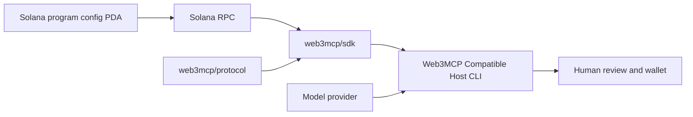

# Web3MCP Node.js SDK and Host CLI Implementation Plan

> **For agentic workers:** Use `superpowers:executing-plans` to implement this plan task by task. Steps use checkbox (`- [ ]`) syntax for tracking.

**Status:** The SDK and single CLI are built and locally tested on `staging`. All 38 local-validator integration tests passed, and packed installs worked outside the monorepo. npm publication and a provider-backed Devnet read/write rehearsal remain pending.

**Goal:** Publish a reusable Node.js Web3MCP SDK to npm and build one Web3MCP Compatible Host CLI that uses the SDK to chat with and operate compatible Solana programs.

**Architecture:** Extract the existing generic Solana runtime into `@web3mcp/sdk`. The single `web3mcp` CLI demonstrates how another Node.js agent host imports that SDK. The CLI owns the model loop, terminal interface, human approval, and wallet; the SDK owns validation, discovery, account reads, instruction preparation, simulation, and signed-message verification.

**Tech stack:** Node.js, TypeScript, ESM, npm workspaces, `@solana/web3.js`, Anchor coders, existing `@web3mcp/protocol`, `tsup`; [Ink](https://github.com/vadimdemedes/ink) and [Ink UI](https://github.com/vadimdemedes/ink-ui) for the CLI chat interface.

**Spec:** [Project design](../specs/2026-10-13-web3mcp-project-design.md), [protocol v0.1 candidate](../../../protocol/SPEC.md), and [native host decision](../../adr/0012-native-llm-seam-and-interactive-wallet-handoff.md).

## Global constraints

- No MCP server, MCP client, or MCP adapter is involved. The SDK and host read the program-owned config PDA through Solana RPC.
- The first release is Node.js only. Protocol and SDK discovery start from a program ID; the Host CLI may resolve `.sns` names before discovery. Other language SDKs remain deferred.
- There is **one** end-user host CLI and **one** chat interface. Replace the separate `web3mcp-host` inspector and `web3mcp-agent` binaries with the single command `web3mcp`, named **Web3MCP Compatible Host**.
- The CLI imports `@web3mcp/sdk` through its public exports. It must not keep a private copy of discovery, validation, account reading, or instruction construction.
- The SDK must not import reference-vault source, generated IDL, or hard-coded tool names. Its npm package must not depend on an LLM provider, React, Ink, a terminal, or a local keypair file.
- The LLM proposes calls; the host requests human approval. The model never signs. The host wallet signs only the exact reviewed transaction.
- Before implementation, account for the current uncommitted Devnet edits on `staging` and keep this work isolated from them.

## Product shape

An installed `web3mcp` command opens chat. Typing `/` opens a command menu. `/model` guides provider, masked API key, and model selection in one flow; it saves the key per provider in the operating system credential store. Manual model entry remains available when listing fails. `/wallet` suggests detected local keypairs and accepts another path, while `/rpc` sets the endpoint. The user includes a program ID or `.sns` name in chat; name resolution produces a program ID before SDK discovery. The header shows the program, RPC, wallet address, and discovered tool count. The conversation shows streaming model output and compact tool activity. Reads return decoded results in chat. Writes pause the conversation and show the program, instruction, arguments, resolved accounts and flags, claimed effects, simulation result, and transaction hash. An explicit **Sign** or **Reject** choice controls wallet signing. Discovery, simulation, model, and wallet errors appear in chat without losing the session.

Choose Ink for the persistent transcript, live status, streaming output, and approval panel. Its current release requires Node.js 22 or newer and React 19.3 or newer; keep that floor on the Host CLI while testing the SDK's Node support separately. Verify Ink UI compatibility with the selected Ink version in an install and real-terminal smoke test before locking versions. [Ink releases](https://github.com/vadimdemedes/ink/releases) · [Ink package requirements](https://raw.githubusercontent.com/vadimdemedes/ink/master/package.json) · [Ink UI package requirements](https://raw.githubusercontent.com/vadimdemedes/ink-ui/main/package.json)

The CLI demonstrates the integration pattern for other Node.js agents. It does not modify an unchanged Codex, Claude Code, or Codex Desktop installation. Their documented third-party custom-tool paths currently use MCP ([Codex](https://developers.openai.com/plugins/build/mcp-server), [Claude Code](https://code.claude.com/docs/en/features-overview)); that is outside this no-MCP release.

## Package and file map

| Path | Responsibility |
| --- | --- |
| `protocol/` | Normative format, validator, conformance fixtures, and npm dependency. Its validator CLI is a developer tool, not another host app. |
| `packages/sdk/` | Public Node.js SDK: discovery, tool registry, reads, instruction preparation, simulation, signed-message verification, and submission. |
| `apps/host/src/agent/` and `apps/host/src/llm/` | Existing chat loop and model drivers, adapted to import the SDK. |
| `apps/host/src/tui/` | Ink chat screen, input, activity display, status, and transaction approval. |
| `apps/host/bin/web3mcp.js` | Sole end-user CLI entry point and npm `bin` target. |
| `docs/` | SDK quickstart, Host CLI guide, wallet boundary, and release instructions. |

Keep the current generic method names in the SDK: `discover(programId)`, `getTools(programId?)`, `getTool(name, programId?)`, `executeRead(name, args, options)`, and `prepareInstruction(name, args, options)`. Export typed results and errors. Add a signing-independent `submitSignedTransaction(prepared, signedTransaction)` operation that checks the signed message against the reviewed, simulated one before broadcast and confirmation. The host supplies the signer and human approval; SDK methods do not infer approval from a model call.

## Review focus

1. **Untrusted publication:** Wrong program ownership, unpublished config, bad digest, malformed JSON, and unsupported bindings fail before tools appear in chat.
2. **Transaction integrity:** Failed simulation, changed signed message, wrong signer, or expired blockhash cannot reach broadcast; re-preparation requires another review.
3. **Approval routing:** Chat input cannot answer its own approval prompt; rejection never signs and resumes the conversation cleanly.
4. **Terminal behavior:** Narrow terminals, long output, resize, non-TTY launch, Ctrl+C, and model errors do not corrupt the interface or leave raw mode enabled.
5. **Package independence:** Installing packed packages outside the monorepo provides working SDK exports and the one `web3mcp` binary, including compiled `dist/` files.

## Task 1: Extract and package the generic SDK

**Files:** Create `packages/sdk/package.json`, `tsup.config.ts`, `tsconfig.json`, `src/`, and tests; move generic modules from `apps/host/src/{accounts,discovery,instructions,tools}`, `errors.ts`, and `index.ts`; update root workspace and lockfile.

- [ ] Write a failing package-level test that imports the SDK and discovers a local-validator program from only its program ID and RPC connection.
- [ ] Move generic code once and preserve validation, error behavior, and existing method signatures. Keep model, wallet, and terminal code in `apps/host/`.
- [ ] Move generic host tests to the SDK package. Use protocol fixtures for malformed publications and a two-program registry fixture for duplicate tool-name handling.
- [ ] Build and test a TypeScript consumer. Confirm the SDK package and dependency tree exclude model SDKs, React, Ink, terminal prompts, and keypair loading.
- [ ] Review and commit only the extraction and its tests.

## Task 2: Make wallet handoff reusable and exact

**Files:** Modify `packages/sdk/src/instructions/`; add a signed-transaction submission module and tests; update `apps/host/src/wallet/` to use the SDK verification path.

- [ ] Test successful approved signing plus changed message bytes, wrong signer, failed simulation, expired blockhash, and confirmation failure.
- [ ] Return a typed prepared result containing the exact transaction message and hash, signer, accounts, effects, simulation, and last valid block height.
- [ ] Implement `submitSignedTransaction(prepared, signedTransaction)` without a private key. Verify the signed message and required signatures, then broadcast and confirm. Require a new preparation and human review after expiry.
- [ ] Keep local-keypair handling as one Host CLI wallet implementation. Document its trust boundary; a future external wallet can use the same host-side signing contract.
- [ ] Run focused SDK and host tests, then commit the handoff change.

## Task 3: Replace the two CLIs with one chat TUI

**Files:** Create `apps/host/bin/web3mcp.js` and `apps/host/src/tui/`; modify `apps/host/package.json`, build config, root scripts, `apps/host/src/agent/`, and wallet review code; remove `apps/host/bin/{inspect,agent}.js` after parity checks.

- [ ] Write an agent test with a stub model proving read, approved write, rejected write, and invalid tool call all go through `@web3mcp/sdk` public methods.
- [ ] Make `web3mcp` the only host `bin`. Parse startup options with Node's standard `parseArgs`; require a TTY for chat and keep `--help` and `--version` usable without one.
- [ ] Build one Ink screen for transcript, status, input, tool activity, and transaction review. Reuse existing LLM drivers and agent loop. Use Ink UI components only after their selected versions pass a compatibility smoke test.
- [ ] Route the agent approval callback into the TUI. Disable chat input while approval is open; default to rejection and never sign from a model response or CLI flag.
- [ ] Test screen input and approval states, then exercise the actual CLI in a PTY for streaming, resize, Ctrl+C, and clean exit. Remove old inspector and agent binaries only when the single interface covers their relevant discovery, tool-listing, read, and write flows.
- [ ] Commit the single-CLI change with updated usage docs.

## Task 4: Verify the demo and release the npm packages

**Files:** Update package manifests, READMEs, root scripts, `docs/roadmap.md`, and release documentation.

- [ ] Confirm ownership of the `@web3mcp` npm scope and choose prerelease versions while protocol v0.1 remains a candidate. Publish in dependency order: `@web3mcp/protocol`, `@web3mcp/sdk`, then `@web3mcp/host` if the CLI is distributed through npm.
- [ ] Configure `files`, exports, and build-before-pack scripts. Run `npm pack --dry-run --json` with a writable cache and install real tarballs in a temporary project outside the monorepo. Import SDK exports and run the single `web3mcp` binary there. This must catch the current host tarball's missing `dist/` files.
- [ ] Run the full local suite and local-validator read, rejected call, and approved write flows. Rehearse a provider-backed Devnet chat, read, and human-approved write through the SDK-backed CLI; keep credentials and wallet files outside the repository.
- [ ] Update SDK and Host CLI guides with one copyable Node import example and one `web3mcp` launch example. Record which results came from tests versus a live provider or Devnet run.
- [ ] Prepare package contents, versions, release notes, and npm commands for Kunal's review before the external publish action.

## Release acceptance

- A separate Node.js project installs the packed SDK and imports its public methods without any host or TUI dependency.
- Exactly one end-user Host CLI command, `web3mcp`, opens chat and uses that same SDK package for all program-specific operations.
- The Host CLI demonstrates discovery, tool listing, a read, an invalid-call rejection, and a write that is simulated, reviewed, signed, and confirmed.
- Altered or expired transactions cannot be submitted through the SDK helper, and rejected reviews do not sign.
- The CLI works from a packed install, not only npm workspace links; unrelated `staging` edits remain intact.

## Deferred

Another language SDK, `.sol` resolution, mainnet execution, autonomous signing, separate inspector or agent apps, a second example Node.js host, and Codex/Claude integration. A second compatible Solana program remains on the broader [demo roadmap](../../roadmap.md) rather than this SDK-and-one-CLI release plan.
