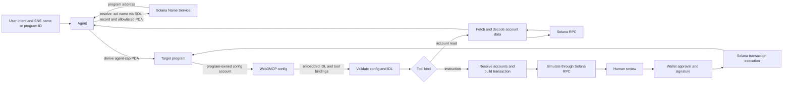
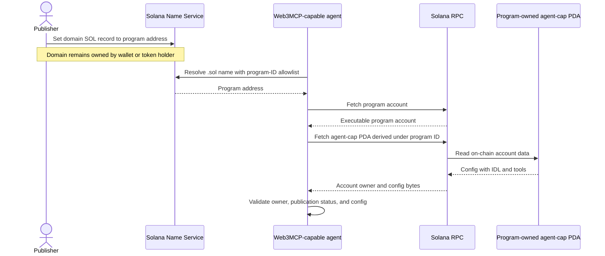
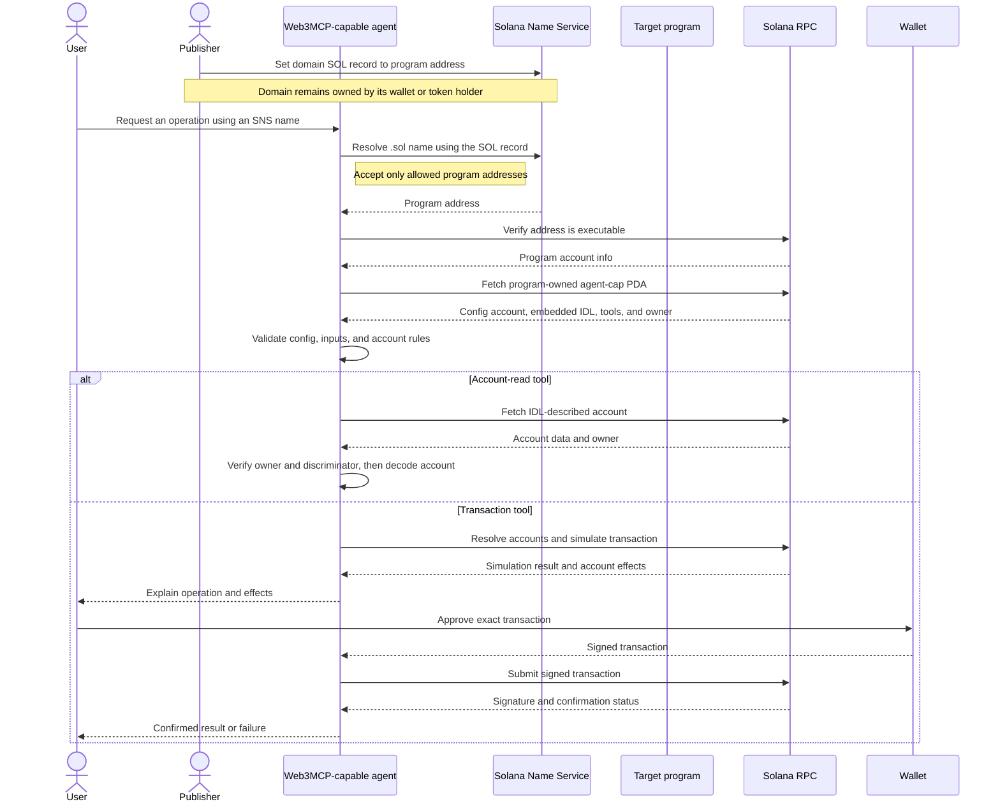
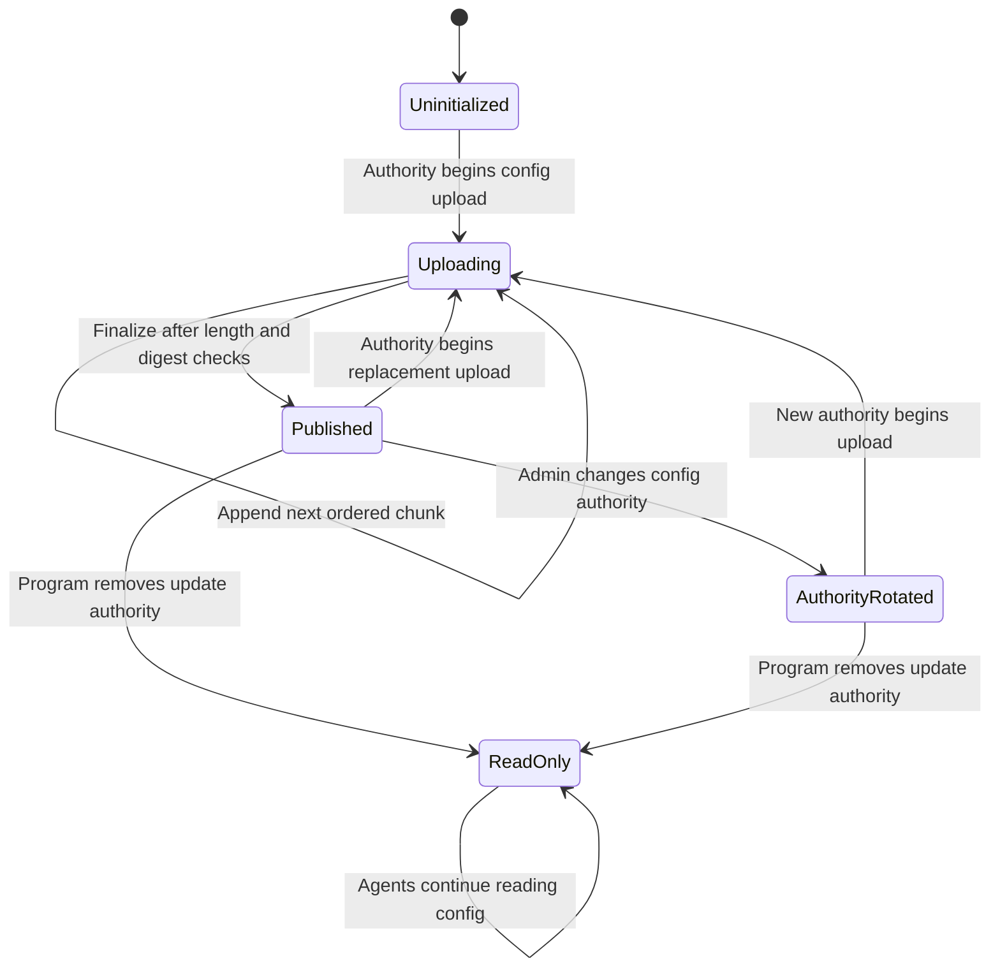

# Web3MCP — Design Spec

**Status:** Superseded technical draft · **Date:** 2026-10-09

The [current project design](2026-10-13-web3mcp-project-design.md) makes the generic LLM host and documentation site first-class components and defers SNS. This document remains as technical research; its SNS-first scope is not the current implementation target.

## Intent and success

Build Web3MCP: an open, program-published tool interface that lets a Web3MCP-capable agent discover a Solana program through an SNS name, inspect its tools, read program state, and prepare/simulate signed transactions without a program-specific HTTP service, MCP server, or separate Web3MCP client. Direct program-ID discovery is also supported. The agent uses its existing Solana RPC and wallet interfaces. For this first implementation, success means an independent agent runtime can follow the format and read from and invoke the sample program.

This spec assumes a **reference standard plus one working reference implementation**, rather than a production-safe universal executor or a Jupiter integration. The pasted recap selected the program-native approach; this design preserves that direction while reducing the first implementation to something testable. The sample is a small owner-scoped SOL vault, not a swap: a swap needs dynamic route discovery, external quotes, slippage bounds, and protocol-specific account lists, which would obscure whether the proposed interface works.

## Product thesis

The project's whitepaper frames Web3MCP as the agent-facing counterpart to WebMCP: websites expose structured tools in the active page context, while Solana programs publish structured tools in program-owned on-chain state. The team's forecast that agents will become a primary web audience by 2030 is a product hypothesis, not a protocol requirement. Web3MCP focuses on making program capabilities discoverable and callable; it does not assume agents never need a UI or that every Web3 authorization flow is automatically stateless. Wallet signatures authorize transactions, while each program still enforces its own on-chain rules.

## Research baseline and claim limits

| Existing piece | What it already solves | Gap for this project |
| --- | --- | --- |
| [Solana/Anchor IDLs](https://www.anchor-lang.com/docs/basics/idl) and [Anchor PDA metadata](https://www.anchor-lang.com/docs/basics/pda) | Instruction layouts, account flags, many PDA seeds, generated clients | Agent-level intent, effect claims, user-facing approval context, a constrained execution profile |
| [Program Metadata Program](https://github.com/solana-program/program-metadata/blob/main/README.md) | Canonical metadata, including IDLs, at deterministic PDAs | Not required here because the supported IDL is embedded in the target program's Web3MCP config |
| [Codama](https://github.com/codama-idl/codama) | Rich program IDL and client generation | A published agent-facing contract and independent safety policy; some dynamic resolution remains open in [its issue tracker](https://github.com/codama-idl/codama/issues/264) |
| [Solana Actions](https://solana.com/docs/tools/actions) | Signable transactions from an HTTP Actions API | Direct program-published discovery without an Actions server |
| [Solana Agent Kit](https://github.com/sendaifun/solana-agent-kit/blob/v2/README.md) | Agent tools/plugins for many protocols | A program-authored interface discoverable from a program ID |

**Research conclusion:** these primary sources did not show a single adopted standard combining canonical program publication, semantic inputs, account resolution, effect claims, and wallet-gated execution. This is a bounded search result, **not** proof that no similar project exists. Before presenting a novelty claim or formal standard proposal, repeat a focused ecosystem scan and ask maintainers for feedback.

The on-chain Web3MCP config is a **program-owned PDA** derived from `["agent-cap"]` under the target program ID. The target program implements the account and its publication/update instructions, so the account owner is the target program itself. The configured authority is stored in that PDA and must sign updates; initialization must be gated by the program's existing admin/upgrade authority to prevent first-writer takeover. The config contains the supported program IDL plus the tool descriptors and Solana bindings, so an agent does not need to fetch a second program-specific metadata record. For SNS discovery, the publisher associates the domain with the program address through its SOL record; the agent enables PDA resolution only for allowed program IDs and verifies that the resolved address is executable. A `.sol` domain remains owned by its wallet or token holder. Direct program IDs follow the same executable and config-PDA checks. The agent still needs generic Web3MCP protocol support, Solana RPC access, and a wallet interface. Existing programs must adopt the interface; it cannot be added to an arbitrary deployed program without changing that program.

## Architecture



The target program owns the single `agent-cap` PDA containing the complete protocol config, including the IDL needed for the supported profile. Standard Solana RPC is sufficient to fetch it; SNS is only a name-to-program-address discovery mechanism.

## Scope

### First release

1. A versioned Web3MCP JSON tool config specification, examples, and validation rules.
2. A self-contained on-chain config format containing the supported program IDL, WebMCP-shaped tool descriptors, and Solana execution bindings. A Web3MCP-capable agent resolves SNS names (or accepts a direct program ID), verifies the executable program, reads the **program-owned** `agent-cap` PDA, and validates the config. No separate Web3MCP client or MCP server is part of the protocol deployment.
3. A deliberately small resolver profile: signer address, fixed program address, and PDA/account defaults that the supported Anchor IDL already describes. The SNS profile defines how a name maps to a program address and rejects ordinary wallet results. The runtime rejects a capability it cannot resolve without custom logic. It does not run code named or fetched by the config.
4. Two on-chain tool kinds: `accountRead` fetches and decodes an IDL-described account through the agent's existing Solana RPC; `instruction` builds exactly one Anchor instruction. The agent validates inputs and resolves accounts against the embedded IDL; transaction tools check signer/writable flags and pin the selected program ID.
5. A pre-sign workflow that simulates state-changing calls, displays the instruction, accounts, signer/writable privileges, claimed effects, simulation result, and conservative balance changes. Every state-changing call requires fresh, explicit wallet approval of the exact transaction message. The runtime has no private key.
6. A sample Anchor `agent_vault` program with `initialize`, `deposit`, and `withdraw` instruction tools plus a `get_vault` account-read tool, with local-validator end-to-end tests. A minimal reference agent demonstrates SNS and direct-ID discovery, reads, preparation, simulation, and wallet handoff using its existing wallet interface. Devnet publication is a release milestone, not a prerequisite for local correctness.

### Default minimum tool set

For a stateful program that supports user actions, publish at least one `accountRead` tool for each important user-readable state and one `instruction` tool for each supported user action. The sample uses `get_vault`, `initialize`, `deposit`, and `withdraw`. A read-only program can publish only reads; a write-only program can publish only instructions, though it should expose relevant state reads where practical. SNS resolution, fetching the config, account decoding, transaction construction, simulation, wallet approval/signing, submission, and confirmation are generic agent runtime operations—not contract-declared Web3MCP tools.

### Deferred

Arbitrary third-party programs, arbitrary RPC lookup expressions, executable resolvers, multi-instruction recipes, quotes/swaps, delegated signing, session keys, autonomous transaction submission, MCP adapters, mainnet, and a universal effect decoder. These require separate designs and threat reviews. Simulated view-like instructions are deferred; v0.1 read tools fetch and decode account data only. Solana RPC exposes account reads such as `getAccountInfo`; instruction execution uses transactions or simulation, not a generic HTTP-style view call. See [Solana account reads](https://solana.com/docs/rpc/http/getaccountinfo) and [SNS name resolution](https://docs.sns.id/dev/sns-sdk/editor).

## Protocol contract: Web3MCP config v0.1

This is the **on-chain tool configuration** analogous to a WebMCP tool registration. It is stored durably in an account owned by the target program. WebMCP keeps registrations in a document's runtime model context; the website's JavaScript supplies the descriptor and executable callback. On Solana, the descriptor fields are stored in the program-owned account, while the executable behavior is identified by the program instruction and runs when Solana executes the transaction. The [current WebMCP draft](https://webmachinelearning.github.io/webmcp/) defines `name`, `title`, `description`, `inputSchema`, `annotations`, and an `execute` callback; this config mirrors the serializable fields and gives the callback a Solana-native binding.

| WebMCP tool registration | On-chain tool record |
| --- | --- |
| `name`, optional `title`, `description` | Same descriptor fields, persisted in the config |
| `inputSchema` (JSON Schema) | Same field; validated, then mapped to instruction arguments or account-address inputs |
| `annotations` | Same `readOnlyHint` and `untrustedContentHint` fields; hints only |
| JavaScript `execute(input)` callback | `solana.kind` selects an instruction transaction or an account read; the agent performs the declared operation using its existing Solana RPC and wallet interfaces |
| Browser/user-agent invocation and consent | Account reads use RPC; state changes use simulation and explicit wallet approval |

The program cannot store a JavaScript callback on-chain. The `solana` section is the declarative execution binding that replaces the callback; it is not arbitrary code and the agent must not treat it as one. This preserves WebMCP's useful tool-definition shape while using Solana's native instruction execution.

The program-owned config account contains an Anchor discriminator, an update `authority: Pubkey`, a publication status, an expected length and SHA-256 digest, and `config: Vec<u8>`. The v0.1 format sets an application-level maximum of 64 KiB; this is not Solana's account-size limit. Solana permits account data up to 10 MiB, and each account needs a refundable storage deposit proportional to its size. The transaction packet limit and per-instruction account-growth limit mean publishers must upload config bytes in multiple bounded transactions. The publisher starts an upload, appends ordered chunks, and finalizes only after length and digest checks pass. Agents use only finalized configs, so interrupted uploads fail closed; readers may temporarily be unable to use the config during an update. The config is UTF-8 JSON with exactly `standard`, `version`, `programId`, `idl`, and `tools`. Unknown top-level fields and unsupported major versions fail validation. `standard` is `web3mcp`, `version` is `0.1.0`, `programId` is the Base58 target program address, and `idl` is the complete supported Anchor IDL object. The publisher updates the IDL and tool bindings together in this config. The agent reads the account at finalized commitment when supported and rechecks it before wallet handoff; these checks reduce stale-config risk but do not make simulation atomic with execution. The program validates authority, upload order, digest, and size; agents validate the JSON schema before use. Configs exceeding 64 KiB are outside v0.1 and require a later storage profile. See [Solana account limits and storage](https://solana.com/docs/core/accounts/account-structure), [transaction size limits](https://solana.com/docs/core/transactions), and [runtime limits](https://solana.com/docs/core/constants-reference).

Each record in `tools` has the WebMCP-shaped fields `name`, optional `title`, `description`, `inputSchema`, and optional `annotations`, plus a required `solana` object. Names are unique ASCII identifiers; descriptions and titles are human text and **untrusted content**. `inputSchema` is a JSON Schema object with `type:"object"`, `properties`, `required`, and `additionalProperties:false`. Supported schema inputs are string-encoded `u64` (decimal integer pattern), boolean, and Base58 `publicKey`; `u64` values remain integer values in the builder, with no floating-point conversion. For this sample, the amount unit is **lamports**, stated in the property's description.

`solana.kind` is either `instruction` or `accountRead`:

- `instruction` requires `instruction`, `accounts`, and `effects`. The instruction must match exactly one published Anchor IDL instruction; its arguments must match `inputSchema` properties exactly.
- `accountRead` requires `account` and `accounts`. `account` must name an account defined by the IDL and owned by the target program. The client resolves its address from IDL PDA metadata and the declared input/account bindings, fetches it with `getAccountInfo`, checks owner and discriminator, and decodes it using the IDL. Its `inputSchema` describes the values needed to resolve the account address; it does not call a program instruction.

For both kinds, `accounts` maps IDL account names to `{source:"signer"}`, `{source:"input", input:"<input property>"}`, `{source:"program", address:"<program id>"}`, or `{source:"idl"}`. The `idl` source permits only deterministic defaults and PDA seeds supported by the Anchor client. Unresolved or circular dependencies fail closed. The config cannot add accounts absent from the IDL, override signer/writable flags, or select a different program. The builder compares resolved instruction metas to the IDL before simulation. Remaining/optional accounts and address lookup tables are unsupported in v0.1.

`annotations` mirrors WebMCP's two hints, `readOnlyHint` and `untrustedContentHint`; they are advisory and never control execution policy. `accountRead` requires `readOnlyHint:true` and omits `effects`. `instruction` requires `readOnlyHint:false`; its `solana.effects` is a **claim by the publisher**, with required booleans `stateChanging` and `financial` and optional `summary`. The agent labels these as claims, never verified results. The runtime treats every instruction tool as state-changing. Account reads require no wallet signature; every instruction tool requires manual approval, and `financial:true` adds prominent balance-change presentation. Neither annotations nor effects grant permission or relax wallet policy. Data returned from account reads is treated as untrusted chain data.

Illustrative abbreviated manifest (the test fixture will contain all IDL accounts):

```json
{
  "standard": "web3mcp",
  "version": "0.1.0",
  "programId": "<sample-program-id>",
  "idl": {"address":"<sample-program-id>","metadata":{"name":"agent_vault"},"instructions":["... compiled IDL contents ..."]},
  "tools": [{
    "name": "deposit",
    "title": "Deposit SOL",
    "description": "Deposit lamports into your vault",
    "inputSchema": {
      "type": "object",
      "properties": {"amountLamports":{"type":"string","pattern":"^[1-9][0-9]*$","description":"Lamports to deposit (u64)"}},
      "required": ["amountLamports"],
      "additionalProperties": false
    },
    "annotations": {"readOnlyHint":false,"untrustedContentHint":false},
    "solana": {
      "kind": "instruction",
      "instruction": "deposit",
      "accounts": {
      "owner": {"source":"signer"},
      "vault": {"source":"idl"},
      "systemProgram": {"source":"program","address":"11111111111111111111111111111111"}
      },
      "effects": {"stateChanging":true,"financial":true,"summary":"Moves SOL from owner to vault"}
    }
  }]
}
```

The exact published sample config is generated from the compiled IDL after the program ID is fixed. It is never a hand-maintained placeholder. The JSON schema is normative for shape; this prose is normative for trust and execution behavior. A compatibility fixture and golden vectors pin encoding and PDA results so another agent runtime can implement v0.1. A separate `get_vault` tool uses `kind:"accountRead"`, exposes an `owner` public-key input, and returns the decoded vault account without a transaction or wallet signature.

## Sample program contract

`vault = PDA(["vault", owner public key], agent_vault program ID)`. The published tools are `get_vault` (account read), `initialize`, `deposit(amountLamports)`, and `withdraw(amountLamports)` (instructions). `get_vault` accepts an owner public key, derives the vault from IDL PDA metadata, fetches it, and returns decoded account data without a transaction. `initialize` creates an owner-scoped vault account; double initialization fails. `deposit` requires the owner signer, a positive amount, and a vault owned by this program with matching owner, then transfers lamports from the owner. `withdraw` requires the same owner signer and a positive amount, checks the vault's available balance above rent exemption, and credits only the owner. Arithmetic is checked. No third-party destination, admin drain, token support, fees, or upgrade governance is in the demo. The sample is educational and unaudited.

## Agent flow and boundaries

This diagram isolates SNS discovery: the domain owner points the SOL record at the program, and the agent verifies the resolved program before reading its config.





```text
SNS name → program ID → program-owned config PDA (tools + IDL) → validation
→ account-read tool: fetch and decode through RPC
→ instruction tool: build transaction → simulate → human review → wallet signs
→ submit via Solana RPC → confirmation/receipt
```

The LLM, if present, chooses a capability and proposes typed inputs. It never selects a signer key, modifies the built transaction after review, or signs. The agent's existing wallet receives the exact serialized message and independently displays/authorizes it. The reference agent demonstrates the protocol; there is no separate Web3MCP SDK or MCP client/server deliverable. Program metadata text and RPC logs are data, never instructions to the agent.

At discovery time a Web3MCP-capable agent can project each on-chain record into a WebMCP-like descriptor (`name`, `title`, `description`, `inputSchema`, `annotations`) and bind it to the agent's built-in transaction/read handling. The config carries declarations, never executable code.

## On-chain config account lifecycle



Agents consume only the `Published` state. During replacement upload, reads fail closed until finalization. Authority rotation and permanent read-only mode are later lifecycle options unless the sample program needs them for its demo.

Preparation fails on missing or unpublished config, unsupported IDL/config version, malformed embedded IDL, bad Base58, zero/overflow amount, unsupported account rule, any extra account or privilege, program-ID mismatch, or missing signer. Before handoff, rebuild with a recent blockhash, simulate that exact message, and present `simulation.err`, logs, units, account deltas when available, estimated fee, and a clear **unknown** when an effect cannot be decoded. A successful simulation is a preflight signal, not proof of final outcome; other transactions can change state, and simulated balance deltas do not prove economic value or intent. The wallet approval screen must always include the full destination/account list and raw instruction summary. On failure or unknown critical effects, no handoff occurs. After submission, wait for confirmation and report the signature plus chain status, rather than calling simulation “success.” [Solana simulation](https://solana.com/docs/rpc/http/simulatetransaction) and [transaction signing](https://solana.com/docs/core/transactions/signing-in-production) provide the underlying primitives.

## Test and acceptance matrix

| Area | Acceptance evidence |
| --- | --- |
| Interoperability | Fixture config, JSON schema, embedded-IDL validation vectors, PDA/account vectors, and an independent fixture-reader example |
| Discovery | Local-validator test reads the target program-owned `agent-cap` PDA containing tools and IDL, then discovers by SNS name and program ID; wrong account owner or malformed embedded IDL fails |
| Resolution | Same semantic input produces the expected instruction bytes and exact account metas; unsupported/circular/missing resolver inputs fail |
| Program safety | Local-validator tests cover owner-only withdrawal, zero amount, overdraw/rent reserve, double initialization, and wrong vault/owner |
| Pre-sign | Simulated failure blocks handoff; success produces human-readable review data and a transaction that the wallet must approve; config/account changes trigger re-preparation |
| End to end | On local validator: initialize → deposit → withdraw; verify balances and transaction signatures/confirmation, with no HTTP protocol adapter |
| External trial | An engineer who did not build the runtime follows README to discover and invoke the sample from program ID; record unclear or missing spec details |

## Delivery gates

1. **Feasibility/novelty gate:** verify embedded-IDL config size on a local validator, and scan current projects/SIMDs. If the exact standard already exists, contribute to it instead of branding a duplicate.
2. **Protocol gate:** publish v0.1 schema and vectors, get one independent agent-runtime review, and freeze the narrow profile for the demo.
3. **Implementation gate:** sample program, reference-agent flow, and adversarial tests pass locally.
4. **Demo gate:** a wallet-controlled local transaction path is recorded; a devnet deployment is optional and needs explicit operational approval before publishing. Mainnet is excluded.

## Open product questions for review

- Is the first intended outcome a Fall School/hackathon demo of a proposed standard, or an agent-runtime feature meant for external program authors immediately? This spec assumes the former.
- Should a later version target Anchor only, Codama first, or both? v0.1 supports the sample's Anchor IDL and does not claim universality.
- What exact wallet/UI should host review and signing in a later product? The reference CLI proves the boundary but is not a consumer wallet experience.

These questions do not block the documented v0.1 implementation. They determine later compatibility and adoption work.
